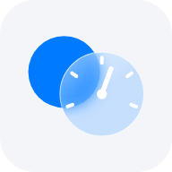

<p align="center">
  
</p>

<h1 align="center">nDashMo</h1>

<p align="center"><b>Dashboard meets Motion.</b><br>
A car home screen for an Android tablet as your car head unit.</p>

nDashMo puts map, music, clock and car info in one dashboard, with two themes (Matte and Glass). It runs as an
Android Home app that shows the pages in `launcher-prototype/` in a WebView. Built and tested on a Samsung Galaxy
Tab A7 Lite (Android 14, One UI 6.1). Made by [@faizald.jo](https://www.threads.com/@faizald.jo).

Project notes for working on it are in `CLAUDE.md`.

## Install on a tablet (sideload)

No computer needed. Download the APK from this repo's
[Releases](https://github.com/faizaldjoo/Samsung-Tab-Revamp/releases) on the tablet, then:

1. Tap the APK and allow installing apps from your browser when Android asks. Play Protect may warn about an unknown
   developer: choose "Install anyway".
2. Android 13 and newer: Settings > Apps > nDashMo > ⋮ (top right) > **Allow restricted settings**. Without this,
   Accessibility and Notification access stay greyed out for a sideloaded app.
3. Press Home and choose nDashMo (or Settings > Apps > Default apps > Home app).
4. Open Controls > Details: the About page lists what is still off (Location, Notification access, Accessibility)
   and opens the right setting.

Needs Android 8 or newer. Split screen and the Bluetooth pop-up use Samsung One UI; sleep and wake follow the
tablet's charging. The offline map is not included; the map uses the network.

`android-native/` is an early start of a native version without the WebView (package me.faizal.carnative: map,
media listener, UI helpers, tablet data). It is not built by `android/build.sh` yet.

## Try it in a browser

```bash
python3 -m http.server 8765 --directory launcher-prototype
```

Then open http://localhost:8765/lite.html (Matte) or http://localhost:8765/glass.html (Glass). Add `?drive` to either
for a simulated drive. The browser shows sample data; the real data comes from the tablet.
`lite-light.html` is a light version of Matte (prototype, not in the app yet).

## Moving to another computer

1. Clone this repo.
2. Copy `android/carhome.keystore` and `android/keystore.properties` from the old computer into `android/` (they are
   not in the repo, see "Signing key" below).
3. Set up the tools in "What you need", then follow "Steps".

## Build and install on the tablet

### What you need

- A JDK and the Android SDK command-line tools, with `build-tools` and `platforms;android-34`.
- `ANDROID_HOME` set to the SDK folder (the script falls back to the Homebrew path on a Mac).
- `adb`. On Windows, run the build script from Git Bash or WSL; it is a bash script.

### Signing key (not in the repo)

`android/carhome.keystore` and `android/keystore.properties` are git-ignored on purpose. **Copy both from the
computer that built the app before into `android/` on the new one, and keep a backup.** Without them the script makes
a new key, and Android will not install that build over the app already on the tablet: you would have to uninstall it
first and lose its settings.

### Steps

1. On the tablet: Settings > Developer options > Wireless debugging, on (it turns off after every restart).
2. Find the tablet:
   ```bash
   adb mdns services
   ```
3. Build and install (use the serial `adb devices` shows):
   ```bash
   ADB_SERIAL=<tablet-serial> android/build.sh install
   ```
   Without `install`, the script only builds `android/build/carhome.apk`. For a release, copy it into `release/`
   (git-ignored) and attach it to a GitHub Release; never commit APKs or the signing key.

### Offline map (Sumedang + greater Bandung)

The map works without signal inside Sumedang regency, Bandung, Cimahi, Bandung regency and West Bandung; elsewhere it
uses the network. The map file (about 55 MB) is not in the repo or the APK: build it and copy it to the tablet with

```bash
ADB_SERIAL=<tablet-serial> offline-map/build.sh install
```

It fetches the area's map tiles from OpenFreeMap (about 2,500 tiles, a few minutes; needs Python 3) into
`offline-map/data/sumedang-bandung.mbtiles` (git-ignored), then copies it to the tablet. The file survives app
updates; run it again every few months for new roads. Uninstalling the app deletes it.

### After installing

- Updating the app turns its accessibility service off on this tablet. Turn it back on: Controls > nDashMo card >
  "Turn on", or Settings > Accessibility > Installed apps > nDashMo. It is needed for sleep when unplugged, wake when
  plugged in, split screen and recent apps.
- On a first install: make nDashMo the default Home app, and allow Location and Notification access. The About page
  (Controls > Details) shows what is still off and opens the right setting.
